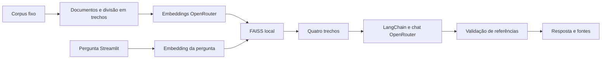

# 📚 RAGDocs

Assistente local para consultar documentação de **LangChain e FAISS**, com perguntas
e respostas em português. Cada resposta documental apresenta os trechos usados e
links para as fontes oficiais. Quando a coleção não sustenta a resposta, o
assistente informa que o contexto é insuficiente.

MVP acadêmico em Python 3.11, com **LangChain + FAISS em CPU**, interface Streamlit e
OpenRouter. As perguntas são independentes: o histórico é apenas visual.

## Instalação

Use Python **3.11** e execute os comandos na pasta que contém este README. A
instalação foi verificada em macOS com Apple Silicon. Em outros sistemas, é
necessário que as dependências nativas de FAISS tenham distribuição compatível.

```bash
python3.11 -m venv .venv
source .venv/bin/activate
python -m pip install -r requirements.lock
python -m pip install --no-deps --no-build-isolation -e .
```

No Windows, a ativação correspondente é `.venv\Scripts\activate`. O arquivo
`requirements.lock` fixa também as dependências de desenvolvimento. Para atualizar
o ambiente de forma deliberada, use `pip-compile pyproject.toml --extra dev
--output-file requirements.lock --strip-extras` e execute novamente os testes.

## Configuração e orçamento

```bash
cp .env.example .env
```

Edite o `.env` local e preencha `OPENROUTER_API_KEY`. Use uma **chave dedicada com
limite total de US$ 1, sem renovação automática**, configurado no OpenRouter. A CLI
confere esse limite antes de construir um novo índice ou executar a avaliação paga.
O teto se refere ao consumo desta chave, não ao saldo geral ou à compra de créditos.
Não envie a chave em mensagens nem a adicione ao Git.

Os padrões são:

| Configuração | Valor |
|---|---|
| `RAGDOCS_CHAT_MODEL` | `openai/gpt-4.1-mini` |
| `RAGDOCS_EMBEDDING_MODEL` | `openai/text-embedding-3-small` |
| Dimensão dos embeddings | 1536 |
| Trechos recuperados | 4 |
| Tamanho / sobreposição | 1200 / 200 caracteres |
| Pergunta / resposta | até 1000 caracteres / 700 tokens |
| Timeout / repetição transitória | 30 segundos por chamada / até uma repetição |

Os dois modelos são acessados pelo OpenRouter; não é necessária uma chave direta da
OpenAI. Alterar o modelo de embeddings exige reconstruir o índice. Modelos
alternativos precisam aceitar a dimensão configurada; o modelo de chat precisa
suportar saída estruturada. Alterar somente o modelo de chat não reindexa documentos.

## Executar

```bash
python -m ragdocs.cli build-index
streamlit run app.py
```

Abra o endereço local exibido pelo Streamlit, normalmente `http://localhost:8501`.
O índice compatível é reaproveitado em execuções posteriores. A interface não gera
embeddings documentais nem reconstrói índices automaticamente.

Experimente:

- “O que é recuperação aumentada por geração (RAG)?”
- “O índice IVF precisa de treinamento antes de adicionar vetores?”
- “Como criar um índice simples e adicionar vetores no FAISS?”
- “Qual é o cardápio do restaurante universitário hoje?” — informação ausente.

Expanda as fontes abaixo da resposta para conferir texto, documento, revisão e link.
O botão **Limpar histórico** remove as interações visuais da sessão. O histórico
mantém no máximo 20 perguntas e nunca é enviado como memória ao modelo.

## Arquitetura mínima



`src/ragdocs/` separa configuração, contratos, ingestão, índice, provedor, respostas,
interface e CLI. O índice usa vetores normalizados e produto interno para busca por
similaridade de cosseno. A integração FAISS do LangChain recupera os documentos.
O chat usa `ChatOpenRouter`; o adaptador de embeddings implementa a interface
`Embeddings` do LangChain e consulta o endpoint `/embeddings` do OpenRouter.

O modelo devolve uma resposta estruturada com identificadores de trechos. O serviço
aceita somente identificadores recuperados e obtém fontes diretamente do corpus.
Essa validação garante a origem das referências; a correção semântica é verificada
separadamente. Falhas técnicas nunca são apresentadas como contexto insuficiente.

O índice é gravado em formato nativo FAISS e os metadados em JSON, **sem pickle**.
Modelo de embeddings, dimensão, parâmetros de divisão e identidade da coleção
precisam coincidir na recarga. Hashes e metadados também são verificados.

## Coleção documental

São seis fontes congeladas, com revisões e hashes registrados em
[`corpus/manifest.json`](corpus/manifest.json): recuperação e busca semântica do
LangChain; README e tutoriais Flat, IVFFlat e IVFPQ do FAISS. A preparação removeu
elementos de apresentação de MDX e preservou prosa e exemplos Python.

As fontes originais estão em inglês; a aplicação responde em português. Exemplos
de código são documentos e nunca são executados. As consultas não navegam na web.
Veja [`corpus/README.md`](corpus/README.md) para revisões, preparação e atribuições.

## Testes e avaliação

```bash
pytest
ruff check .
python -m pip check
```

A suíte padrão bloqueia conexões de rede. Usa FAISS real com embeddings
determinísticos, HTTP simulado, respostas simuladas e testes de interação Streamlit.
Cobre persistência, compatibilidade, ranking, referências, limites, erros e histórico.

A avaliação real é explícita e faz chamadas pagas:

```bash
python -m ragdocs.cli evaluate --live
python -m ragdocs.cli evaluate --report
```

As 15 perguntas ficam em `tests/fixtures/evaluation.json`: dez respondíveis pela
coleção e cinco sem suporte. Os resultados são salvos a cada pergunta em
`runtime/evaluation/`. Uma nova execução reaproveita resultados concluídos com a
mesma identidade de corpus, modelos, configuração, prompt e implementação.

Falhas técnicas interrompem a rodada e são registradas separadamente. Sua repetição
exige uma decisão explícita: `python -m ragdocs.cli evaluate --live --retry-failed`.
Alterações relevantes criam uma avaliação distinta; chamadas não são repetidas por
um comando de relatório.

Para registrar uma revisão semântica, crie um JSON local com o `fingerprint` do relatório
e um objeto `reviews`. Para cada pergunta respondível, registre `correct` e
`grounded` como booleanos, e `notes` com a justificativa baseada na rubrica e nos
trechos. Exemplo de estrutura:

```json
{
  "fingerprint": "copiar-do-resultado-local",
  "reviews": {
    "q01": {
      "correct": true,
      "grounded": true,
      "notes": "A resposta explica recuperação antes da geração e o trecho citado sustenta isso."
    }
  }
}
```

Importe a revisão com `python -m ragdocs.cli evaluate --review-file
runtime/evaluation/reviews.json`. Não há modelo avaliador pago.

Aceite: fonte esperada nos quatro trechos em pelo menos 8/10 casos; pelo menos 8/10
respostas corretas e sustentadas; recusa em 5/5 casos sem suporte; referências válidas
em todas as respostas. A CLI só marca `accepted` após a revisão registrada.

### Resultado da validação desta entrega

A rodada real processou as 15 perguntas: **10/10 fontes esperadas recuperadas**, **8/10
respostas corretas e sustentadas**, **5/5 recusas de conteúdo ausente** e referências
válidas em todas as respostas. Os trechos foram revisados pelo coordenador com
assistência do Codex, sem contratar um modelo avaliador; não se trata de avaliação
humana independente. O consumo total observado da chave foi **US$ 0,0120927**.

Duas respostas não foram contabilizadas: a enumeração das etapas de busca semântica
colocou embeddings antes da divisão, e a explicação de `nprobe` excedeu o significado
explicitamente documentado no exemplo citado. Esses resultados atendem ao limiar
do MVP e demonstram por que referências válidas não garantem uma resposta correta.

## Limitações e próximos passos

- A cobertura é limitada a seis fontes congeladas, e não a toda a documentação.
- Um trecho parecido pode não responder à pergunta; o modelo ainda pode errar.
- A disponibilidade, latência e cobrança dependem dos modelos no OpenRouter.
- A aplicação é local e não oferece login, upload ou atendimento a vários usuários.
- O pacote `langchain-community` usado na integração emite aviso de depreciação;
  as versões verificadas estão fixadas. Uma migração poderá ser avaliada depois.

Possíveis extensões: ampliar e revisar a coleção, melhorar a recuperação e oferecer
upload ou memória conversacional. Elas não fazem parte desta entrega.

## Git, créditos e licença

Código, testes, corpus, dependências e instruções operacionais permanentes são
versionados. Credenciais, índices, avaliações, planejamento, prompts de
desenvolvimento, handoffs e estado de ferramentas são ignorados. `AGENTS.md`
documenta a operação; os prompts usados pelo produto fazem parte do código.

Projeto de Pasique, desenvolvido com assistência do Codex em frentes paralelas de
indexação, respostas e interface, com integração e revisão pelo coordenador.
As respostas da aplicação usam GPT-4.1 mini; a busca usa text-embedding-3-small,
ambos por OpenRouter. LangChain e FAISS fornecem a infraestrutura de recuperação.

Código próprio sob [licença MIT](LICENSE). Documentação do LangChain e FAISS mantém
as atribuições e licenças em [`corpus/licenses/`](corpus/licenses/).
