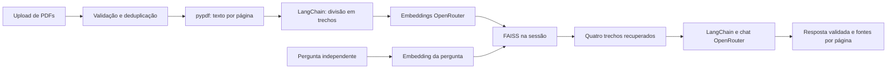

# 📚 RAGDocs

Assistente local para consultar **PDFs escolhidos pelo usuário**, desenvolvido com
**LangChain e FAISS em CPU**, Streamlit e OpenRouter. Envie vários documentos,
processe a coleção e faça perguntas em português. As respostas mostram **nome do
arquivo, página e trecho**; quando falta informação, o assistente informa essa limitação.

As perguntas são independentes. O histórico serve apenas para visualização e mantém
as últimas 20 interações. Não é necessário preparar uma base documental previamente.

## Instalação

Use Python **3.11** e execute na raiz deste repositório:

```bash
python3.11 -m venv .venv
source .venv/bin/activate
python -m pip install -r requirements.lock
python -m pip install --no-deps --no-build-isolation -e .
cp .env.example .env
```

No Windows, ative com `.venv\Scripts\activate`. A instalação foi verificada em macOS
com Apple Silicon; FAISS precisa de distribuição nativa compatível no seu sistema.
`requirements.lock` fixa as dependências de aplicação e desenvolvimento. Atualizações
deliberadas usam `pip-compile pyproject.toml --extra dev --output-file requirements.lock
--strip-extras`, seguidas dos testes.

Preencha `OPENROUTER_API_KEY` no `.env` local. Use uma chave dedicada com limite total
de **US$ 1, sem renovação automática**, no OpenRouter. Esse limite considera todo o
consumo da chave, inclusive testes anteriores. A avaliação confere o teto antes das
chamadas; o limite configurado no provedor também controla o uso da interface.
Não adicione credenciais ao Git.

| Configuração | Padrão |
|---|---|
| `RAGDOCS_CHAT_MODEL` | `openai/gpt-4.1-mini` |
| `RAGDOCS_EMBEDDING_MODEL` | `openai/text-embedding-3-small` |
| Dimensão dos embeddings | 1536 |
| Trechos recuperados | 4 |
| Tamanho / sobreposição | 1200 / 200 caracteres |
| Pergunta / resposta | 1000 caracteres / 700 tokens |
| Timeout / repetição transitória | 30 segundos / até uma repetição |

Os modelos são configuráveis por ambiente, ambos acessados pelo OpenRouter.
O modelo de embeddings deve aceitar a dimensão configurada e o de chat deve
suportar saída estruturada. Não é necessária uma chave direta da OpenAI.

## Usar a aplicação

```bash
streamlit run app.py
```

Abra `http://localhost:8501`:

1. Selecione um ou mais PDFs.
2. Clique em **Processar documentos** e aguarde a criação do índice.
3. Faça uma pergunta sobre o conteúdo e confira as fontes abaixo da resposta.

Exemplo: envie um regulamento de evento e um manual de horta; pergunte o horário do
evento ou como regar os canteiros. LangChain e FAISS são tecnologias da aplicação;
os documentos podem tratar de qualquer assunto.

Selecionar outra coleção invalida imediatamente índice, serviço e histórico.
É necessário processá-la antes de consultar. **Limpar documentos** remove também a
seleção; **Limpar histórico** preserva a coleção processada. Atualizações de tela e
perguntas reutilizam o índice da sessão sem repetir embeddings dos documentos.

## PDFs, limites e privacidade

- Até cinco PDFs, 10 MiB por arquivo e 20 MiB no conjunto.
- Até 100 páginas e 200 mil caracteres extraídos no conjunto.
- PDFs precisam ter texto extraível; não há OCR para páginas digitalizadas.
- Arquivos inválidos, protegidos por senha ou inteiramente sem texto são rejeitados.
- Páginas sem texto são ignoradas, com a quantidade informada na interface.
- PDFs de conteúdo idêntico são deduplicados; arquivos diferentes com o mesmo nome
  mantêm identidades distintas.

Toda a coleção é validada antes de enviar embeddings. Exceder um limite interrompe
o lote inteiro; não há truncamento silencioso nem retorno à coleção anterior.

**PDFs, texto extraído, índice e histórico ficam em memória, na sessão**, sem gravação
pela aplicação em disco ou cache compartilhado entre sessões. Fechar/reiniciar a
sessão exige novo processamento. A biblioteca de extração também limita o tamanho
de streams de página a 10 MiB; estes limites não garantem um teto absoluto de RAM.

Os trechos são enviados ao **OpenRouter** para embeddings e respostas; a pergunta
também é enviada. Portanto, o provedor recebe esse conteúdo e suas políticas de
tratamento de dados se aplicam. Os documentos não são publicados no Git nem usados
como comandos. A aplicação não navega na web ou executa código dos PDFs.

## Arquitetura mínima



`src/ragdocs/` separa configuração, contratos, processamento, índice, provedor,
serviço de respostas, interface e CLI de avaliação. A extração e a divisão ocorrem
por página, preservando a numeração original. A busca usa vetores normalizados e
produto interno, equivalente à similaridade de cosseno, pela integração FAISS do
LangChain. O chat usa `ChatOpenRouter`; o adaptador de embeddings implementa a
interface `Embeddings` do LangChain e acessa `/embeddings` do OpenRouter.

Uma assinatura do conteúdo, nomes e configuração identifica a coleção. A interface
mantém o serviço em `st.session_state`, sem índice persistente ou recarga por disco.
O modelo devolve identificadores de trechos: referências desconhecidas e respostas
malformadas são rejeitadas sem nova chamada automática. As fontes vêm dos metadados,
não de links gerados pelo modelo. Falhas técnicas têm mensagens próprias e nunca
são apresentadas como falta de informação documental.

## Testes e avaliação

```bash
pytest
ruff check .
python -m pip check
```

Os testes bloqueiam a rede. Exercitam extração de PDFs sintéticos, limites,
deduplicação, FAISS real com embeddings determinísticos, HTTP simulado, validação
de respostas e interações Streamlit, incluindo troca de coleção e isolamento de
sessões. As fixtures em `tests/fixtures/pdfs/` são documentos fictícios públicos,
sem relação com LangChain ou FAISS.

A avaliação paga é explícita e usa **somente essas fixtures**, nunca uploads:

```bash
python -m ragdocs.cli evaluate --live
python -m ragdocs.cli evaluate --report
```

`tests/fixtures/evaluation.json` contém dez perguntas respondíveis e cinco sem
suporte. Resultados e trechos dessas fixtures ficam em `runtime/evaluation/`,
ignorado pelo Git. O comando retoma resultados concluídos com a mesma identidade
de documentos, modelos, configurações e implementação. Não salva índices nem PDFs.
Falhas técnicas interrompem a rodada e ficam registradas separadamente. Repeti-las
exige `python -m ragdocs.cli evaluate --live --retry-failed`.

Para revisar a sustentação, crie um JSON local com `fingerprint` e `reviews`, contendo
para cada questão respondível os booleanos `correct` e `grounded`, e uma justificativa
`notes` conferida contra a rubrica e as fontes:

```json
{
  "fingerprint": "copiar-do-resultado-local",
  "reviews": {
    "q01": {
      "correct": true,
      "grounded": true,
      "notes": "Data e horário coincidem com a página citada."
    }
  }
}
```

Importe sem chamadas pagas:

```bash
python -m ragdocs.cli evaluate --review-file runtime/evaluation/reviews.json
```

Aceite: recuperação e respostas corretas e sustentadas em pelo menos 8/10 casos,
recusas em 5/5 e referências válidas em todos. O relatório só marca `accepted` depois
da revisão registrada. Não se contrata outro modelo como avaliador.

## Validação da versão 1.1.0

A avaliação real com os dois PDFs fictícios recuperou as fontes esperadas em **10/10**
casos e produziu **10/10 respostas corretas e sustentadas**, além de **5/5 recusas** e
referências válidas em todas as respostas. A revisão de rubricas e trechos foi feita
pelo coordenador com assistência do Codex; não constitui avaliação humana independente.
O consumo acumulado da chave foi **US$ 0,01956824**, incluindo US$ 0,0120927 anteriores.

Os **141 testes offline** passaram, incluindo interface e processamento integrado
com PDFs sintéticos. Ruff e instalação limpa com as dependências fixadas passaram. Planejamento,
handoffs, checkpoints e justificativas detalhadas permanecem locais e ignorados.

## Limitações

A [extração com pypdf](https://pypdf.readthedocs.io/en/stable/user/extract-text.html)
não reconhece texto presente somente em imagens. Layouts complexos e
tabelas podem perder estrutura. Um trecho semelhante pode não responder à pergunta,
e referências válidas não garantem correção semântica. Latência, disponibilidade e
cobrança dependem do OpenRouter. O MVP é local, sem autenticação ou hospedagem pública.
As versões da integração `langchain-community` estão fixadas e emitem aviso de depreciação.

## Git, créditos e licença

Código, testes, PDFs sintéticos, dependências, prompts do produto e instruções
operacionais em `AGENTS.md` são versionados. Credenciais, uploads, ambientes, índices,
avaliações locais, planejamento, prompts de desenvolvimento, handoffs e estado de
ferramentas ficam fora do Git. A documentação local está em `documentacao_projeto/`.

Projeto de Pasique, desenvolvido com assistência do Codex em frentes paralelas de
processamento, respostas e interface, com integração e revisão pelo coordenador.
Código e fixtures próprios sob [licença MIT](LICENSE).
A versão `v1.0.0` permanece no histórico; `v1.1.0` corrige o fluxo para PDFs enviados.
